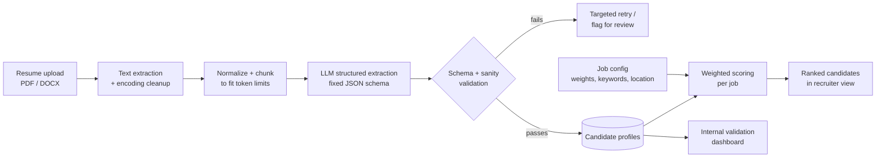

# LLM Resume Extraction & Candidate Scoring (case study)

An LLM pipeline inside a **live applicant tracking system (ATS)** that turns uploaded resumes into structured candidate profiles and ranks candidates against each job with configurable, weighted scoring.

| | |
|---|---|
| **Status** | In production on a recruitment platform |
| **Scale** | **1,000+ resumes** processed into structured profiles |
| **My role** | Designed, built and shipped the extraction pipeline, the scoring and the validation dashboard |

> Built by me as an AI Engineer at DiligentMinds Consulting (2025–2026). The source code is proprietary, so this repo documents the design, decisions and lessons learned. No company code or candidate data is included.

**Stack:** Python · FastAPI · LLM structured output (Gemini / OpenAI) · PostgreSQL · JSON Schema validation

---

## Architecture



## 1. Structured extraction

Each resume becomes one profile following a fixed schema, for example:

```json
{
  "name": "…",
  "contact": { "email": "…", "phone": "…", "location": "…" },
  "summary": "…",
  "skills": ["Python", "FastAPI", "PostgreSQL"],
  "experience": [
    { "title": "…", "company": "…", "start": "2023-06", "end": "present", "highlights": ["…"] }
  ],
  "education": [{ "degree": "…", "institution": "…", "year": "…" }],
  "total_experience_years": 2.5
}
```

- **Schema-first prompting**: the model must return the schema and nothing else, and every response is validated before it's saved.
- **Deterministic post-processing**: dates, experience years and skill names are normalized in code rather than trusted from the model.
- **Failure-aware**: invalid or partial output triggers a targeted retry or sends the profile for review, so a bad parse never silently corrupts a profile.

## 2. Configurable candidate scoring

Recruiters set the weights per job. Each candidate gets a score that can be explained:

```
score = w_skills·skill_match + w_keywords·keyword_match
      + w_experience·experience_fit + w_location·location_fit
```

- **Job-specific**: each job posting has its own weights and must-have vs nice-to-have criteria.
- **Explainable**: the recruiter sees the breakdown behind every rank, not just a number.

## 3. Validation dashboard & production fixes

I built an internal dashboard to compare extracted profiles with the source resumes and find failure patterns. The main production issues I found and fixed:

| Failure | Cause | Fix |
|---|---|---|
| Garbled or merged fields | Malformed layouts (multi-column, tables, text boxes) | Layout-aware text extraction and cleanup before prompting |
| Broken characters | Encoding problems in uploaded files | Encoding detection and normalization |
| Missing later sections | Long resumes hitting **token limits** and getting truncated | Chunking and detection of truncated output, with a retry |

## What I learned
- In production, extraction quality depends mostly on the **input cleanup and validation around the LLM**, not on the prompt.
- A validation dashboard pays off quickly: most real failures came from the inputs (layouts, encodings, length), not from model reasoning.
- Recruiters trust scoring they can see into, so explainable weights beat a single opaque relevance score.

## Author
**Yash Singh** · GenAI Engineer · [LinkedIn](https://linkedin.com/in/yashsinghswe)
